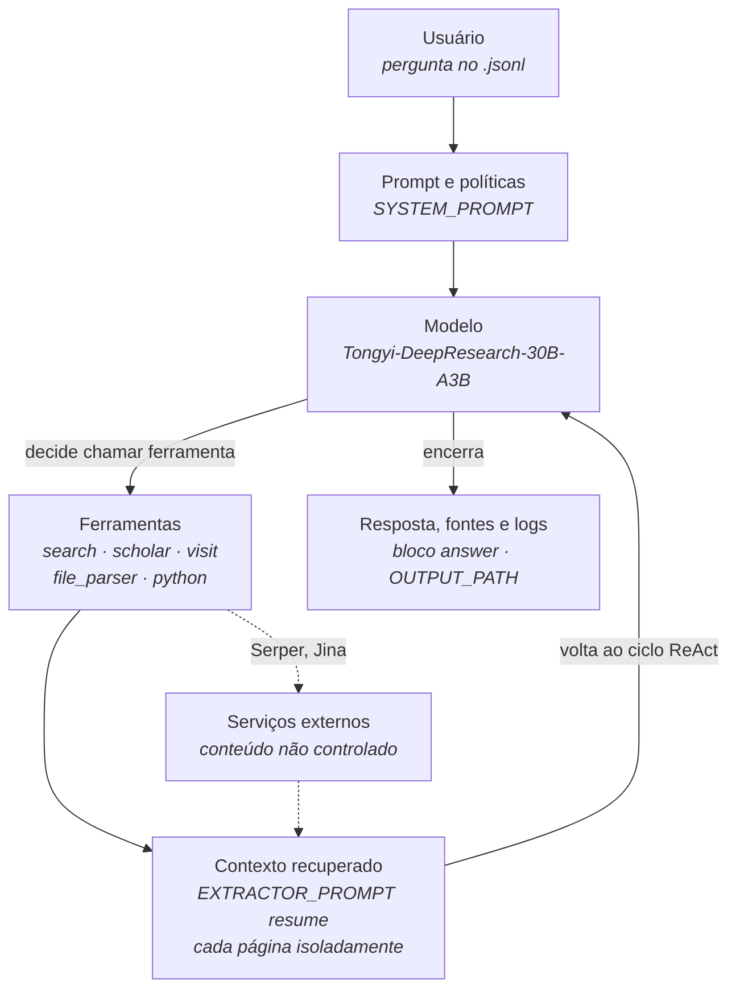

# Parte A — Ficha da missão

**Responsável:** Filipe de Carvalho Godoy
**Missão escolhida:** D — Contexto sob Pressão
**Fluxo de alto interesse avaliado:** busca documental com resposta fundamentada em fontes

---

## A.1 Ficha do sistema

Atualização da ficha elaborada na Atividade 1.

| Campo | Valor |
|---|---|
| Projeto | Tongyi DeepResearch |
| URL | https://github.com/Alibaba-NLP/DeepResearch |
| Organização | Alibaba-NLP / Tongyi Lab |
| Licença | Apache-2.0 |
| Versão / commit avaliado | *a registrar antes da entrega* |
| Data de acesso | *a registrar antes da entrega* |
| Modelo | Tongyi-DeepResearch-30B-A3B — 30,5 bi de parâmetros totais, 3,3 bi ativados por token, contexto de 128 mil tokens |
| Provedor utilizado | *a confirmar com quem executou na Atividade 1* — opções disponíveis: pesos locais (HuggingFace/ModelScope), OpenRouter (`alibaba/tongyi-deepresearch-30b-a3b`) ou Bailian |
| Finalidade | Agente de pesquisa profunda para tarefas de busca de informação de longo horizonte |
| Usuários | Analista ou pesquisador que submete pergunta aberta e recebe texto sintético com as fontes consultadas |
| Supervisão | Humana, antes do uso do resultado — a resposta é insumo para decisão, nunca a decisão |

### Fluxo avaliado

O recorte não abrange todo o projeto. Limita-se ao percurso da pergunta até a resposta final: como o agente planeja a busca, que contexto recupera, como o incorpora ao texto e em que condições afirma algo sem sustentação.

O paradigma de inferência considerado é o **ReAct**, que alterna raciocínio e chamada de ferramenta. O modo "Heavy" (IterResearch), que amplia o esforço em tempo de execução, fica fora do recorte.

### Ferramentas e integrações

| Ferramenta | Serviço externo | Função no fluxo |
|---|---|---|
| `search` | Serper | Busca na web |
| `scholar` | Serper | Busca em base acadêmica |
| `visit` | Jina | Leitura de página |
| *(sumarização)* | API compatível com OpenAI | Resumo do conteúdo lido |
| `file_parser` | DashScope | Leitura de arquivo submetido |
| `python_interpreter` | SandboxFusion | Execução de código em ambiente isolado |

Registradas em `TOOL_MAP`, `inference/react_agent.py`.

### Prompts relevantes

| Prompt | Arquivo | Papel |
|---|---|---|
| `SYSTEM_PROMPT` | `inference/prompt.py` | Define o comportamento do agente e o contrato de saída `<answer></answer>` |
| `EXTRACTOR_PROMPT` | `inference/prompt.py` | Resume cada página visitada antes de devolvê-la ao agente |

Ambos são determinantes para a Missão D: é no `SYSTEM_PROMPT` que falta instrução para declarar evidência insuficiente, e é o `EXTRACTOR_PROMPT` que resume cada página isoladamente, sem reconciliar fontes divergentes.

### Fontes de dados

| Origem | Natureza | Quando entra no fluxo |
|---|---|---|
| Páginas recuperadas da web | Conteúdo de terceiros, não controlado | Em tempo de execução, via `search` e `visit` |
| Resultados de busca acadêmica | Conteúdo de terceiros | Em tempo de execução, via `scholar` |
| Arquivos submetidos pelo usuário | Controlado por quem executa | `eval_data/file_corpus/`, via `file_parser` |
| Perguntas de avaliação | Controlado pela equipe | `.jsonl` apontado por `DATASET` |

---

## A.2 Fluxo simplificado

### Onde a Missão D atua

O experimento da missão intervém em **C — contexto recuperado**, substituindo-o por quatro variantes controladas: correto, ausente, irrelevante e conflitante. Tudo o mais permanece fixo.

Dois pontos do fluxo concentram o risco do recorte:

**O `EXTRACTOR_PROMPT` resume cada página isoladamente.** Não existe etapa que reconcilie fontes divergentes antes de o conteúdo voltar ao modelo. Quando duas fontes se contradizem, a escolha entre elas acontece dentro do modelo, sem registro.

**O conteúdo externo entra sem separação entre dado e instrução.** O que a Jina devolve segue direto para o sumarizador, de modo que o texto de terceiros ocupa o mesmo espaço das instruções do sistema.

Ambos foram levantados por análise estática na Atividade 1 e permaneceram como previsão não verificada. A Missão D os submete a teste.

---

## A.3 Classificação dos dados do recorte

Apenas os dados necessários ao recorte, classificados conforme exigido.

| Dado | Classificação | Observação |
|---|---|---|
| Páginas web recuperadas em execução | **Público** | Conteúdo de terceiros, acessível publicamente. Não é redistribuído no repositório; apenas URLs e trechos citados nas evidências. |
| Documentos de contexto usados nos testes | **Sintético** | Fabricados pela equipe para as Partes B e E. Não podem identificar organização real nem conter dado de terceiro. |
| Perguntas de avaliação | **Sintético** | Elaboradas pela equipe. |
| Código-fonte do DeepResearch | **Público** | Apache-2.0. |
| Chaves de API (`.env`) | **Não permitido para teste** | Credenciais. Não versionadas — `.env` consta no `.gitignore`. Nenhuma chave aparece em evidência, log ou relatório. |
| Logs e trajetórias de execução | **Interno** | Produzidos pela equipe. Revisar antes de publicar: a trajetória pode conter trechos de páginas de terceiros. |

### Dados deliberadamente fora do teste

Conforme a vedação do enunciado, nenhum teste usa dados pessoais reais, credenciais, documentos sigilosos ou conteúdo protegido sem autorização.

Daí decorre uma recomendação para as Partes B e E: **os documentos de contexto devem ser sintéticos.**

Além de cumprir a vedação, isso resolve um problema técnico do recorte. O agente busca na web durante a execução; com perguntas sobre fatos públicos, ele encontraria a resposta fora do contexto fornecido, e as condições "correto", "ausente", "irrelevante" e "conflitante" produziriam resultados semelhantes — justamente a variável que a missão pretende isolar. Documentos sintéticos que não nomeiam organização alguma não deixam o que buscar, e o contexto fornecido passa a ser a única fonte possível de verdade.

A escolha concreta dos documentos cabe às Partes B e E.

---

## A.4 Limitações do recorte

| Limitação | Efeito sobre os resultados |
|---|---|
| Modo "Heavy" (IterResearch) fora do recorte | Os resultados valem para o modo ReAct; o modo Heavy pode se comportar de outra forma |
| Busca ao vivo, sem cache | Execuções em datas diferentes recebem páginas diferentes; a reprodução exata não é possível |
| Ausência de seed determinística | Não foi localizado mecanismo de fixação de amostragem; a variabilidade entre repetições não é eliminável |
| Corpus sintético | Controla bem a variável de contexto, mas o cenário é um dos usos do agente, não o único |
| Dependência de serviços pagos | `file_parser` exige chave DashScope; por isso o contexto do experimento é entregue inline no prompt |

---

## A.5 Pendências desta parte

- [ ] Registrar commit/tag e data de acesso do DeepResearch
- [ ] Confirmar com quem executou na Atividade 1 qual provedor de modelo foi usado
- [ ] Confirmar com a Parte E se o fluxo desenhado em A.2 cobre os pontos que os testes vão exercitar
- [ ] Alinhar com as Partes B e E a recomendação de A.3 sobre documentos de contexto sintéticos
